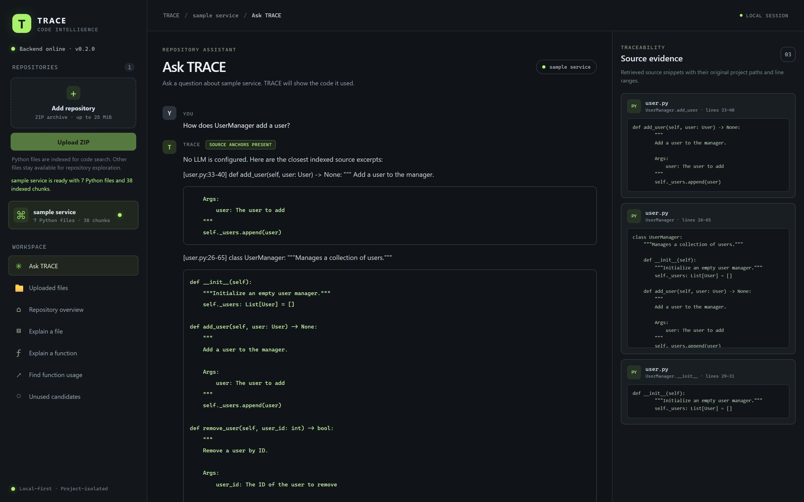
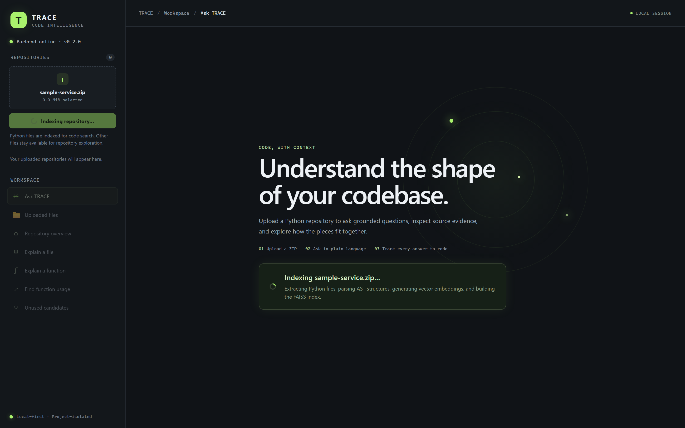
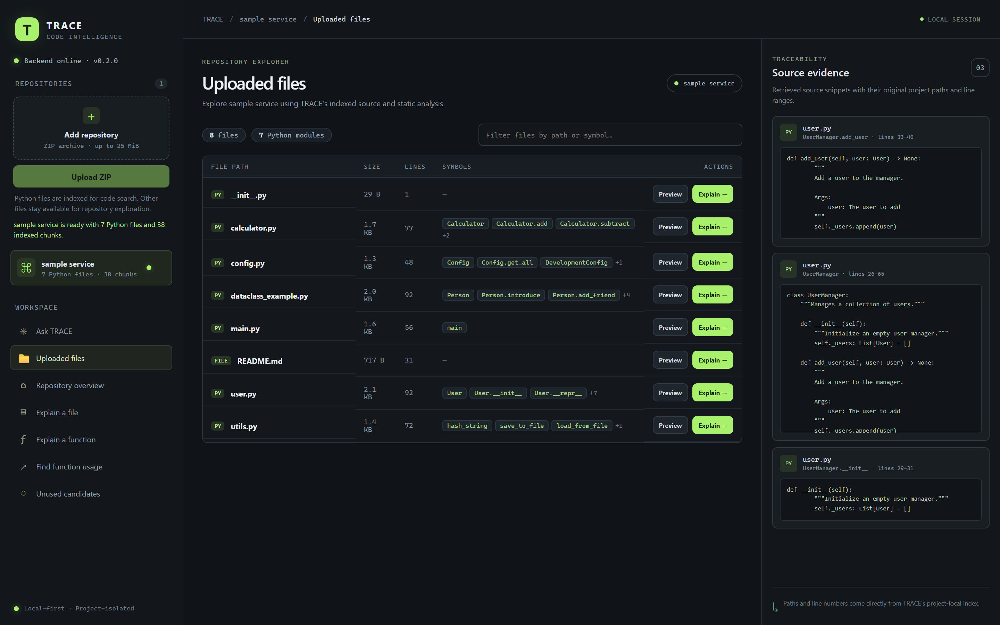
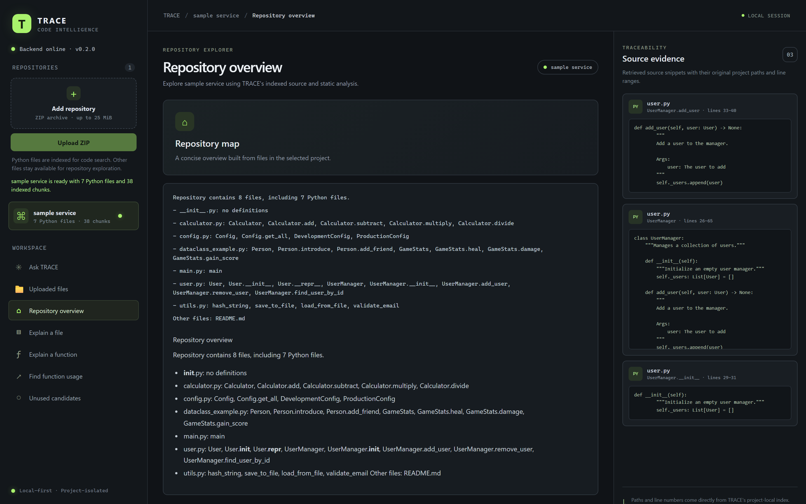
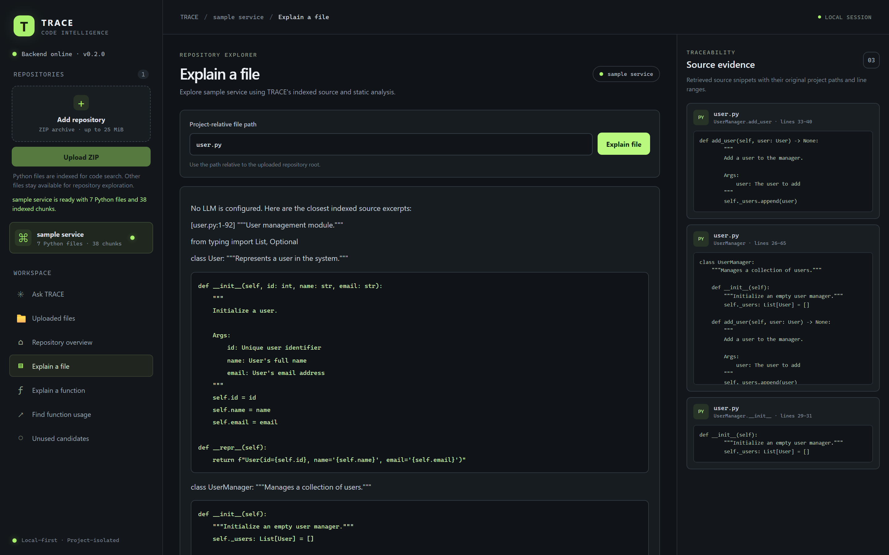
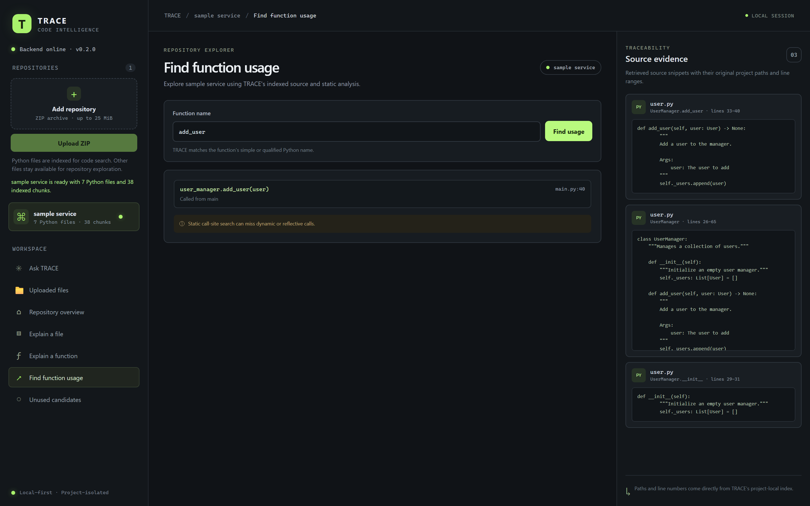
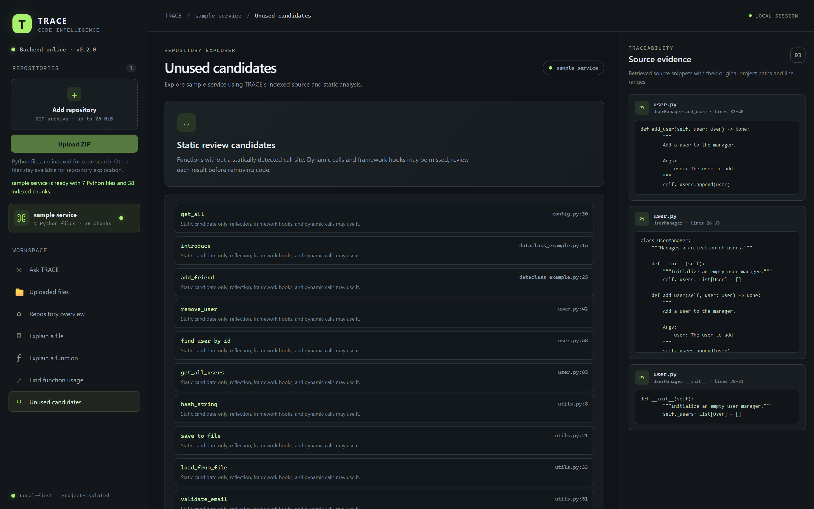

# TRACE

TRACE is a local-first tool I built for exploring Python codebases. Upload a repository as a ZIP, ask a question about the code, and inspect the files and line ranges TRACE used to find its answer.

It also includes a few tools for understanding a repository without reading every file manually: repository summaries, file and function explanations, call-site search, and unused-function candidates.



## What it does

- **Searches code in a few ways.** Hybrid mode combines lexical matching with dense-vector search and merges the rankings. You can also select lexical or semantic retrieval on its own.
- **Shows where an answer came from.** Results include source snippets, file paths, and line ranges so you can check the code instead of taking an answer on trust.
- **Works without an LLM.** In evidence-only mode, TRACE returns matching source evidence rather than generating an explanation. An OpenAI-compatible LLM can be configured separately.
- **Builds an index for each uploaded project.** TRACE extracts the ZIP, parses Python files with `ast`, creates code chunks, and stores the project's metadata and FAISS index separately.
- **Helps you navigate the code.** You can view a repository summary, inspect a file or function, find static call sites, and review functions that appear to have no internal callers.
- **Watches for file changes.** The file watcher can trigger an index rebuild when files in a project change.
- **Lets you manage projects.** Upload, switch between, rename, or delete repositories from the sidebar.

TRACE focuses on Python. Other files can still appear in the repository browser, but Python files are used for AST-based analysis and retrieval.

## How it works

At a high level, the flow looks like this:

```text
 1. Indexing a repository
 ──────────────────────────────────────────────────────────────
  ZIP upload ──► Safe extraction ──► AST parsing ──► Code chunking ──► Project storage
                 (boundary checks)   (symbols)       (token windows)   (./data/<id>/.trace/)
                                                                           │
                                 ┌─────────────────────────────────────────┘
                                 ▼
 2. Asking a question
 ──────────────────────────────────────────────────────────────
  User question ──► Intent router
                           │
           ┌───────────────┴───────────────┐
           ▼                               ▼
     Lexical search                 Semantic search
    (token matching)             (FAISS cosine vectors)
           │                               │
           └───────────────┬───────────────┘
                           ▼
                 Reciprocal Rank Fusion
                           │
                           ▼
                    Grounding check
                 (direct source anchors)
                           │
                           ▼
                Source evidence in the UI
```

The frontend is built with React, TypeScript, and Vite. The backend uses FastAPI. Sentence Transformers creates the code embeddings, and FAISS stores and searches the vectors.

## Run it locally

### Requirements

- Python 3.12
- Node.js and npm
- A machine that can run the embedding model on CPU

TRACE uses `sentence-transformers/all-MiniLM-L6-v2` by default. On the first semantic indexing run, Sentence Transformers downloads the model (around 90 MB). Once it is cached, indexing and retrieval can run locally without downloading it again. No LLM API key is needed unless you want generated explanations.

### 1. Get the code

```bash
git clone https://github.com/Sharon1905/Trace.git
cd Trace
```

Replace the URL and directory name with your GitHub repository details if you cloned from a fork.

### 2. Set up the backend

Create a virtual environment and install the Python dependencies.

**Windows (PowerShell):**

```powershell
python -m venv .venv
.\.venv\Scripts\Activate.ps1
pip install -r requirements.txt
```

**macOS / Linux:**

```bash
python3 -m venv .venv
source .venv/bin/activate
pip install -r requirements.txt
```

Start the backend on port `8001`:

```bash
python -m uvicorn app.main:app --host 127.0.0.1 --port 8001 --reload
```

The backend is available at:

- API: `http://127.0.0.1:8001`
- API docs: `http://127.0.0.1:8001/docs`
- Health check: `http://127.0.0.1:8001/health`

### 3. Set up the frontend

Open another terminal:

```bash
cd frontend
npm ci
npm run dev
```

Open `http://127.0.0.1:5173` in your browser. The Vite development proxy is configured to send API requests to `http://127.0.0.1:8001` by default.

The default setup uses the Vite proxy. To connect the browser directly to the backend instead, set `VITE_TRACE_API_BASE_URL` in `frontend/.env.local` to the backend origin. For example:

```env
VITE_TRACE_API_BASE_URL=http://127.0.0.1:8001
```

A direct connection needs the frontend origin in the backend's `TRACE_CORS_ORIGINS` setting. Do not commit `.env.local` or files containing real credentials.

## Add a repository

TRACE currently accepts ZIP archives.

1. Zip the Python repository you want to inspect.
2. Open TRACE in your browser.
3. Upload the ZIP from the sidebar, or drag it into the upload area.
4. Wait for extraction, parsing, and indexing to finish.
5. Select the project and start exploring it.

Uploaded projects are stored under `./data` by default. Each project has its own metadata and `.trace/` index directory. You can change the storage location with `TRACE_DATA_DIR`.

The upload limits are:

- ZIP size: 25 MiB by default.
- Extracted size: 100 MiB by default.
- Archive entries: 10,000 by default.

These limits can be changed with `TRACE_MAX_UPLOAD_BYTES`, `TRACE_MAX_EXTRACTED_BYTES`, and `TRACE_MAX_ARCHIVE_ENTRIES`. TRACE rejects unsafe archive paths, parent-directory traversal, symlinks, and duplicate entries.





## Exploring a codebase

### Ask a question

Ask about a function, a piece of logic, or how parts of the project connect. For example:

- `Where is authentication handled?`
- `How does the user manager add a user?`
- `Where is email validation implemented?`

The answer view includes the source snippets and line ranges returned by retrieval. In evidence-only mode, TRACE shows the matching code without asking an LLM to write a summary.

There are three retrieval modes:

- **Hybrid:** lexical matching and dense-vector search combined with Reciprocal Rank Fusion.
- **Semantic:** dense-vector search using FAISS.
- **Lexical:** token matching against code chunks and symbols.

### Repository overview

See repository-level information such as Python file counts, lines of code, chunks, classes, functions, and a summary of the project structure.



### Explain a file or function

Select a file to inspect its imports, classes, functions, and source. You can also look up a function to see its signature, parameters, docstring, and detected callers or callees.



### Find function call sites

Search for a function and TRACE will look for static call sites across the indexed Python files. The results include the calling file and line number.



### Find possible unused functions

TRACE can list functions with no detected internal callers. Treat these as candidates to review, not as a safe-to-delete list. Dynamic dispatch, reflection, decorators, and framework routing can make a function look unused even when it is called at runtime.



### Rename or delete a project

Use the three-dot menu on a project in the sidebar to rename or delete it. Deleting a project removes its stored source files, metadata, cache entries, and vector index.

## Configuration

The backend reads configuration from environment variables or a `.env` file in the repository root.

| Variable | Default | What it controls |
|---|---|---|
| `TRACE_DATA_DIR` | `./data` | Where uploaded projects and their indexes are stored. |
| `TRACE_MAX_UPLOAD_BYTES` | `26214400` | Maximum compressed ZIP size (25 MiB). |
| `TRACE_MAX_EXTRACTED_BYTES` | `104857600` | Maximum extracted size (100 MiB). |
| `TRACE_MAX_ARCHIVE_ENTRIES` | `10000` | Maximum number of entries allowed in a ZIP. |
| `TRACE_RETRIEVAL_MODE` | `hybrid` | Default retrieval mode: `hybrid`, `semantic`, or `lexical`. |
| `TRACE_EMBEDDING_MODEL` | `sentence-transformers/all-MiniLM-L6-v2` | Sentence Transformers model used for embeddings. |
| `TRACE_EMBEDDING_DEVICE` | `cpu` | Embedding device, such as `cpu` or `cuda`. |
| `TRACE_EMBEDDING_BATCH_SIZE` | `32` | Number of texts encoded in one batch. |
| `TRACE_EMBEDDING_WINDOW_OVERLAP_TOKENS` | `32` | Token overlap between adjacent embedding windows. |
| `TRACE_SEMANTIC_MIN_SCORE` | `0.30` | Minimum score used to filter semantic results. |
| `TRACE_CORS_ORIGINS` | `http://127.0.0.1:5173,http://localhost:5173` | Browser origins allowed to access the backend. |
| `SKIP_DOTENV` | `false` | Set to `1` or `true` to skip loading the root `.env` file. |

### Optional LLM connection

LLM support is optional. TRACE can use an OpenAI-compatible API for generated explanations. Set these variables in the root `.env` file:

```env
TRACE_LLM_BASE_URL=https://api.openai.com/v1
TRACE_LLM_MODEL=gpt-4o-mini
TRACE_LLM_API_KEY=your-api-key
```

Use the URL and model name for your provider. A local provider may not need an API key. If the LLM base URL or model is not set, TRACE stays in evidence-only mode.

## API

The backend exposes these endpoints. You can also open `/docs` on the running backend to see the interactive API documentation.

| Method | Endpoint | Purpose |
|---|---|---|
| `GET` | `/health` | Backend health and version. |
| `GET` | `/projects` | List stored projects. |
| `POST` | `/upload` | Upload and index a ZIP archive. |
| `PATCH` | `/projects/{project_id}` | Rename a project. Body: `{"name": "New name"}`. |
| `DELETE` | `/projects/{project_id}` | Delete a project and its stored data. |
| `POST` | `/ask` | Ask a question about a project. |
| `GET` | `/project_files` | List project files and extracted symbols. |
| `GET` | `/explain_repo` | Get a repository summary. |
| `GET` | `/explain_file` | Inspect a file. |
| `GET` | `/explain_function` | Inspect a function. |
| `GET` | `/function_usage` | Find static call sites for a function. |
| `GET` | `/unused_functions` | List possible unused functions. |
| `GET` | `/projects/{project_id}/status` | Get indexing and project status. |
| `GET` | `/monitor/status` | Get rebuild and file-watcher status. |
| `GET` | `/monitor/changes` | List detected file changes. |
| `GET` | `/monitor/metrics` | Get operational metrics. |
| `POST` | `/monitor/cache/reset` | Clear the in-memory query cache. |

For example, to upload a ZIP from a terminal:

```bash
curl -F "file=@my-project.zip" http://127.0.0.1:8001/upload
```

## Build the frontend

To create a production build:

```bash
cd frontend
npm ci
npm run build
```

Vite writes the static files to `frontend/dist/`. Host those files with your static web server and run the FastAPI backend separately. Set the frontend API URL and backend CORS origins to match your deployment.

## Scope and limitations

- **Python analysis:** AST-based indexing, call-site search, and unused-function checks are focused on `.py` files. Other files can be browsed, but they are not part of Python AST analysis.
- **Static call analysis:** TRACE only sees calls it can identify from source code. Dynamic dispatch, reflection, `getattr`, decorators, and framework routing can hide runtime calls.
- **Unused-function results:** A function with no detected internal callers is only a candidate. Check it before removing anything.
- **Evidence checks:** The grounding check uses overlap between the question and retrieved code as one filter. It helps avoid unrelated results, but it does not prove that an answer is correct. Check the cited code yourself.
- **LLM answers:** When an external LLM is enabled, generated explanations can still be wrong. The source snippets are there so you can verify them.
